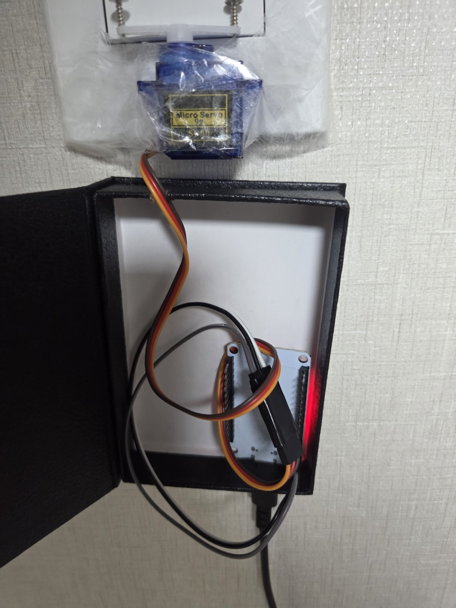

# ESP32 형광등 스위치

ESP32와 SG90 서보로 벽 형광등 로커 스위치를 누른다. 교류 배선은 만지지 않는다.

폰은 보드가 집 Wi-Fi에서 여는 페이지로 켜기와 끄기를 보낸다. 예약은 보드가 저장하고, 페이지를 닫아도 그 시각에 실행한다.

켜기는 105도, 끄기는 70도다. 그 각도에 도착하면 신호를 끊어 모터 힘을 뺀다.

## 결과

<video src="result-video.mp4" controls playsinline width="480" poster="result-img.jpg"></video>

[결과 영상 파일]

[▶ 시연 영상 보기]([./result-video.mp4](https://github.com/user-attachments/assets/7d9378ce-6c3c-4b20-ab0b-0a4344d75468))

## 하드웨어

- ESP32 Dev Module (ESP32-D0WD-V3, WROOM-32, 4MB, CP2102)
- SG90. 주황선 GPIO13, 빨간선 VIN, 갈색선 GND
- 전원은 5V USB. 서보 빨간선은 3.3V에 연결하지 않는다.

## 펌웨어

Arduino IDE에서 `firmware/LightSwitch/LightSwitch.ino`를 연다. 보드는 **ESP32 Dev Module**, 포트는 업로드에 쓰는 COM 포트다.

처음 켜면 설정용 Wi-Fi `LightSwitch`(비밀번호 `lightswitch`)가 뜬다. 폰에서 `http://192.168.4.1`에 들어가 집 2.4GHz Wi-Fi를 저장한다. 이후 공유기 기기 목록의 주소로 페이지를 연다.
